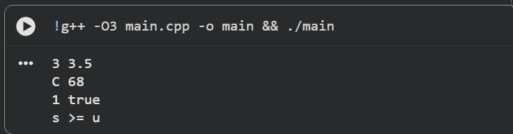
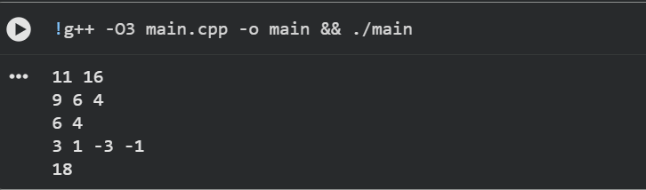

# DSA01 – Assignment 1 (CO1): Metro Smart-Card Fare Logic

* **Name:** V.Bala Siva Prasad Reddy
* **Register number:** 192424316
* **Compiler:** g++ (Ubuntu 13.3.0-6ubuntu2~24.04.1) 13.3.0
* **Compile command (all programs):** `g++ -std=c++17 -Wall -Wextra FILE.cpp -o NAME`

## How to run

Open a terminal inside a task folder, then compile and run, for example:

    cd Task06
    g++ -std=c++17 -Wall -Wextra t6_fare.cpp -o t6_fare
    ./t6_fare

Task 8 reads its input from a file:

    cd Task08
    g++ -std=c++17 -Wall -Wextra t8_gate.cpp -o t8_gate && ./t8_gate < gate_input.txt
    g++ -std=c++17 -Wall -Wextra t8_alt.cpp -o t8_alt && ./t8_alt < alt_input.txt

Each program is one self-contained .cpp file. Output screenshots are in each task's `screenshots/` folder.

## Result of each task

|Task|Folder|Programs|Result|
|-|-|-|-|
|1|Task01|– (analysis, UML)|Object model & UML diagram analysis documented (see NOTES.md)|
|2|Task02|t2_macro, t2_enum|Macro side effects (3+4*2=11 vs 14); enum class prevents implicit conversions|
|3|Task03|t3_types|Validates type choices, bounds, and unsigned station IDs|
|4|Task04|t4a, t4_fixed|t4a gives one -Wsign-compare warning; t4_fixed resolves it cleanly|
|5|Task05|t5, t5_peak_table|Peak vs off-peak surcharge calculation verified against timetable|
|6|Task06|t6_fare, t6_boundary|Fare logic correctly evaluates base fares, discounts, and boundary limits|
|7|Task07|t7_procedural, t7_oop, t7_public|OOP encapsulation protects state compared to procedural/public access|
|8|Task08|t8_gate, t8_alt|Gate state machine processes batch check-in/check-out input streams|
|9|Task09|t9_tests|Automated test suite passes all unit test and edge cases|
|10|Task10|t10_totals|Running totals, daily trips, and revenue calculated correctly|
|11|Task11|– (recommendation)|Comprehensive architecture and encapsulation recommendation|
|12|Task12|t12_old, t12_new|t12_old gives one -Wswitch warning; t12_new handles all enum cases|

---

## Output Screenshots

### Task 02 – Macros vs Enum Class

### Task 03 – Data Types & Floating Point Precision

### Task 04 – Signed vs Unsigned Comparisons & Narrowing

### Task 05 – Peak Fare Calculation

### Task 06 – Fare Logic & Boundary Tests

### Task 07 – Procedural vs Encapsulated OOP

### Task 08 – Gate Validation & Input Streams

### Task 09 – Unit Testing Edge Cases

### Task 10 – Daily Revenue & Summary Totals

### Task 12 – Old vs New Fare Logic (Compiler Warnings)

